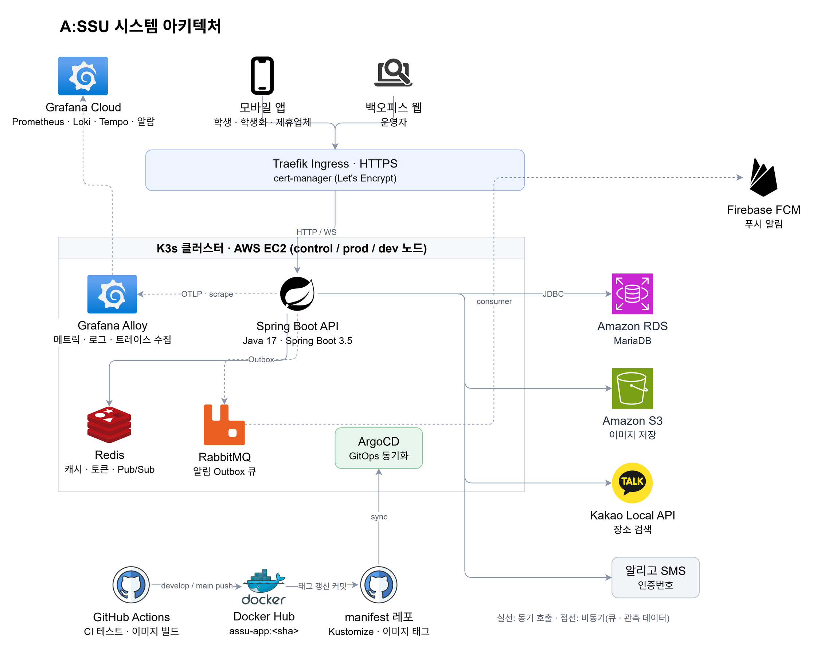

# 🎓 A:SSU (숭실대학교 종합 제휴 플랫폼)


> **"제휴의 시작부터 끝까지, A:SSU에서 한 번에!"**  
> 🏆 **제5회 숭실대학교 IT 프로젝트 공모전 수상작**

[📱 Google Play Store](#) | [💻 GitHub Repository](#) | [📄 API 명세서 (Swagger)](#)

---

## 📋 목차
1. [프로젝트 개요](#-프로젝트-개요)
2. [팀원 소개](#-팀원-소개)
3. [주요 기능](#-주요-기능)
4. [기술 스택](#-기술-스택)
5. [시스템 아키텍처](#-시스템-아키텍처)
6. [배포](#-배포)
7. [프로젝트 구조](#-프로젝트-구조)
8. [문의](#-문의)

---

## 🎯 프로젝트 개요

대학교 주변 제휴 혜택은 정보가 분산되어 있어 학생은 이용이 번거롭고, 학생회는 매 학기 제휴 관리 부담이 컸으며, 제휴업체는 인증 과정의 비효율과 홍보 효과 측정의 한계를 겪고 있었습니다.

**A:SSU**는 제휴 계약부터 이용까지의 흐름을 하나의 시스템으로 통합해, 위치 기반 검색과 모바일 인증으로 이용 절차를 단순화하고 제휴 이용 현황을 데이터로 관리할 수 있도록 설계된 플랫폼입니다.

### ✨ 주요 특징
* 🔐 **다중 인증 시스템**: 일반 회원가입, SSU 포털 연동, 토큰 기반 인증
* 💬 **실시간 채팅**: WebSocket 기반 실시간 1:1 메시징
* 📍 **위치 기반 서비스**: 공간 데이터(Spatial)를 활용한 지도 서비스 및 주변 매장 탐색
* 🔔 **푸시 알림**: Firebase FCM 및 Outbox 패턴을 통한 신뢰성 있는 실시간 알림
* 📊 **관리자 백오피스**: 종합적인 회원, 매장, 제휴 및 통계 관리 기능

---

## 👥 팀원 소개 (Team Members)

| 이름 | 학과 / 학번 | GitHub / Contact |
| :---: | :---: | :---: |
| 이수민 | 컴퓨터학부 23학번 | [@leesumin0526](https://github.com/leesumin0526) |
| 이호근 | 컴퓨터학부 21학번 | [@2ghrms](https://github.com/2ghrms) |
| 백종원 | 컴퓨터학부 23학번 | [@BAEK0111](https://github.com/BAEK0111) |
| 김예원 | 컴퓨터학부 24학번 | [@kimyw1018](https://github.com/kimyw1018) |
| 이서희 | 컴퓨터학부 24학번 | [@eeeeeaaan](https://github.com/eeeeeaaan) |


---

## ✨ 주요 기능

| 기능 | 설명 |
| :--- | :--- |
| **👤 회원 관리** | 학생/파트너 회원가입 및 프로필 관리 |
| **🔐 인증/인가** | JWT 기반 인증, 학생·파트너·관리자 역할 권한 관리 |
| **🏦 매장 관리** | 파트너 매장 등록·수정, 위치 기반 매장 검색 |
| **🤝 제휴 관리** | 제휴 제안·수락 및 제휴 현황 관리 |
| **💬 실시간 채팅** | WebSocket / STOMP 기반 1:1 실시간 채팅 |
| **📍 위치 기반 서비스** | Hibernate Spatial 기반 주변 매장 탐색 및 지도 |
| **🔔 푸시 알림** | FCM 기반 실시간 알림 (Transactional Outbox 패턴 적용) |
| **📱 디바이스 관리** | FCM 토큰 관리 및 멀티 디바이스 지원 |
| **⭐ 리뷰 및 신고** | 매장 리뷰 작성/관리 및 부적절한 콘텐츠 신고 처리 |
| **📊 관리자 기능** | 사용자·매장·제휴 통합 관리 및 데이터 통계 제공 |
| **📖 API 문서화** | SpringDoc OpenAPI (Swagger UI) 지원 |

---

## 🛠 기술 스택

| 항목 | 사용 기술 / 라이브러리 |
| :--- | :--- |
| **Backend** | Spring Boot 3.5.3, Java 17, Spring Data JPA (Hibernate), Spring Security, Spring Batch, Spring AOP, WebFlux(WebClient) |
| **Database** | MariaDB (Amazon RDS), Hibernate Spatial · JTS (위치 데이터), H2 (테스트) |
| **Cache · Session** | Redis (리프레시 토큰, 로그아웃 블랙리스트, 채팅 Pub/Sub) |
| **Messaging** | RabbitMQ (Transactional Outbox), Firebase Cloud Messaging (FCM) |
| **Real-time** | WebSocket, STOMP (채팅, 그룹 QR 인증) |
| **Auth** | JWT (jjwt), 역할별 UserDetailsService 체인, 백오피스 전용 audience |
| **External API** | AWS S3 (이미지), Kakao Local API (장소 검색), 알리고 SMS |
| **Observability** | Spring Actuator, Micrometer (Prometheus), Micrometer Tracing (OpenTelemetry) → Grafana Alloy → Grafana Cloud (Prometheus · Loki · Tempo) |
| **Infra** | AWS EC2 (K3s 클러스터, control / prod / dev 노드), Traefik Ingress, cert-manager, ArgoCD (GitOps), Kustomize |
| **CI/CD** | GitHub Actions, Docker (멀티 스테이지 빌드), Docker Hub |
| **API Docs · Build** | SpringDoc OpenAPI (Swagger UI), Thymeleaf (QR 딥링크 페이지), Gradle |

## 🏗 시스템 아키텍처



- 클라이언트 요청은 Traefik Ingress(HTTPS, cert-manager)를 거쳐 K3s 클러스터 안의 Spring Boot 앱으로 들어온다. prod와 dev는 네임스페이스와 노드가 분리돼 있다.
- 앱은 Amazon RDS(MariaDB)와 S3를 쓰고, Redis·RabbitMQ는 네임스페이스마다 클러스터 안에 둔다. 알림은 Outbox 테이블 → RabbitMQ → FCM 순으로 비동기 전송한다.
- 메트릭·로그·트레이스는 네임스페이스별 Grafana Alloy가 모아 Grafana Cloud로 보내고, 알람은 Discord로 받는다.
- 배포는 GitHub Actions가 이미지를 빌드해 manifest 레포의 태그를 갱신하면 ArgoCD가 클러스터에 반영한다(아래 🚢 배포).

## 📁 프로젝트 구조
```text
src/main/java/com/assu/server/
├── domain/                     # 도메인별 비즈니스 로직
│   ├── admin/                  # 학생회 계정
│   ├── appreview/              # 앱 리뷰
│   ├── auth/                   # 인증 (로그인, 회원가입, 탈퇴, JWT, Security)
│   ├── backoffice/             # 백오피스 운영자
│   ├── certification/          # QR 인증 (개인/그룹)
│   ├── chat/                   # 채팅 (학생회 ↔ 제휴업체)
│   ├── common/                 # 공통 엔티티, 공통 enum
│   ├── deviceToken/            # FCM 디바이스 토큰
│   ├── inquiry/                # 학생 문의
│   ├── map/                    # 지도 · 장소 검색 (Kakao Local API)
│   ├── member/                 # 공통 회원 (프로필 이미지)
│   ├── notification/           # 알림 (FCM, RabbitMQ Outbox)
│   ├── partner/                # 제휴업체
│   ├── partnership/            # 제휴 계약 (Paper, PaperContent, Goods)
│   ├── qr/                     # QR 코드 (임시 QR, 딥링크 리다이렉트)
│   ├── report/                 # 신고
│   ├── review/                 # 가게 리뷰
│   ├── store/                  # 가게
│   ├── student/                # 학생 (유세인트 토큰 인증)
│   └── suggestion/             # 학생 → 학생회 제안
├── global/                     # 전역 설정 및 유틸리티
│   ├── apiPayload/             # BaseResponse, 공통 응답 코드
│   ├── config/                 # Security, Redis, WebSocket, Observation 등
│   ├── exception/              # 전역 예외 처리
│   ├── security/               # 인증 에러 핸들러
│   └── util/                   # 유틸리티
├── infra/                      # 외부 서비스 연동
│   ├── aligo/                  # 알리고 SMS
│   ├── firebase/               # FCM
│   ├── messaging/              # RabbitMQ 설정
│   └── s3/                     # AWS S3
└── ServerApplication.java
```
## 도메인별 구조
각 도메인은 다음과 같은 계층 구조를 따릅니다. DTO는 `record`이고 변환 메서드는 DTO 안의 static 팩토리로 둡니다.
```text
domain/example/
├── controller/                 # REST API 컨트롤러
├── service/                    # 비즈니스 로직 (@Transactional)
├── repository/                 # 데이터 액세스
├── entity/                     # JPA 엔티티
│   └── enums/                  # 도메인별 enum
├── dto/                        # 요청/응답 record (+ 변환 static 메서드)
└── exception/                  # 도메인별 예외, validator, annotation
```
## 🚢 배포

GitHub Actions가 이미지를 만들고, 배포 자체는 ArgoCD가 manifest 레포(`ASSU_BE_manifest`, Kustomize)를 보고 K3s 클러스터에 반영하는 GitOps 방식입니다.

```text
develop / main push
  → GitHub Actions: 테스트 → Docker 이미지 빌드 → Docker Hub (assu-app:<commit sha>)
  → manifest 레포 overlays/{dev,prod}/deployment-patch.yaml 의 이미지 태그 갱신 커밋
  → ArgoCD (3분 폴링, 자동 sync · selfHeal) → K3s 클러스터 파드 교체
```

| 항목 | dev | prod |
| :--- | :--- | :--- |
| 트리거 | `develop` push | `main` push (develop → main 배포 PR) |
| 네임스페이스 · 노드 | `assu-dev`, dev 노드 | `assu-prod`, prod 노드 |
| 배포 전략 | Recreate (배포 중 잠시 503) | RollingUpdate (maxSurge 1, maxUnavailable 0, 무중단) |
| 헬스체크 | startup · readiness · liveness probe (`/actuator/health/*`, 8081 관리 포트) | 동일 + 외부 Synthetic probe |

- **CI**: `develop` 대상 PR·push마다 `./gradlew test`. 문서만 바뀐 커밋은 CD를 건너뜁니다.
- **롤백**: manifest의 이미지 태그를 직전 SHA로 되돌리는 커밋 한 번이면 됩니다. ArgoCD hard refresh를 함께 하면 push 후 약 1분 반 안에 새 파드가 Ready 됩니다(dev 실측).
- **설정**: 프로파일별 yml은 비공개 `config` 서브모듈에 있고 빌드 시 `src/main/resources`로 복사됩니다. 비밀값은 K8s Secret으로 주입합니다.
- 자세한 절차(접속, 롤백, 장애 대응, 모니터링)는 [`docs/guide`](docs/README.md)를 참고하세요.

## 📞 문의
프로젝트에 대한 문의사항이 있으시면 다음을 통해 연락해 주세요:

팀 이메일: assu.soongsil.cse@gmail.com
A:SSU © 2026

