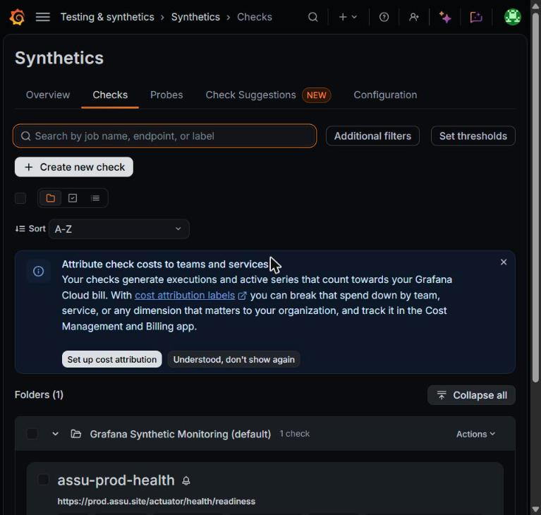
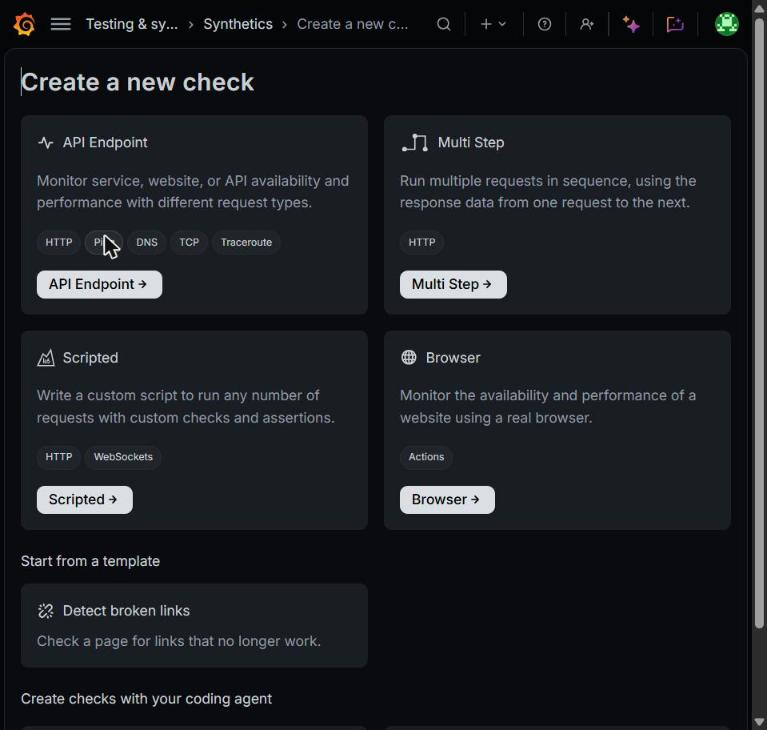
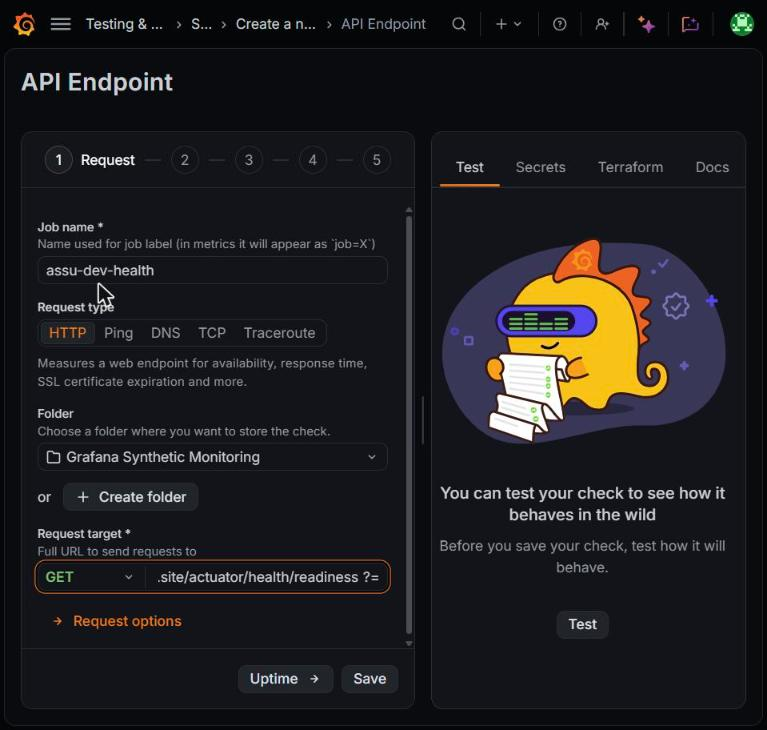
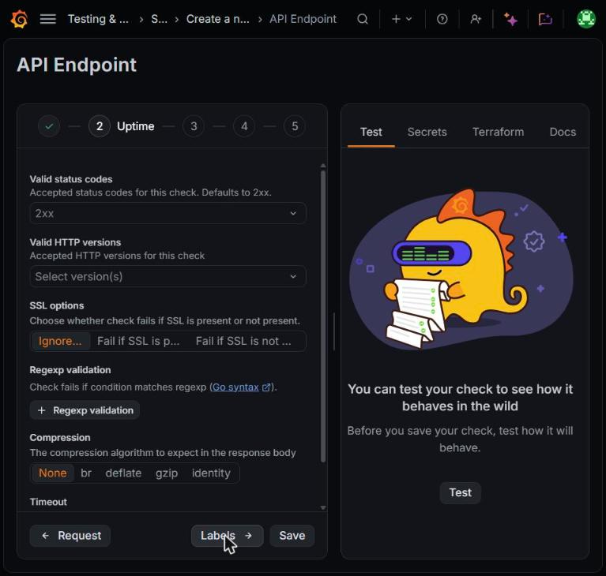
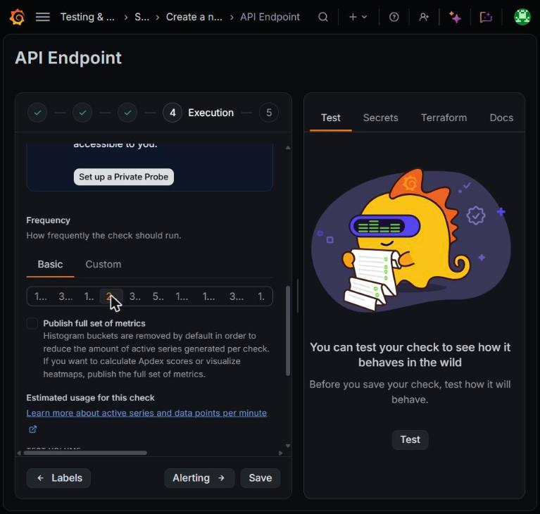
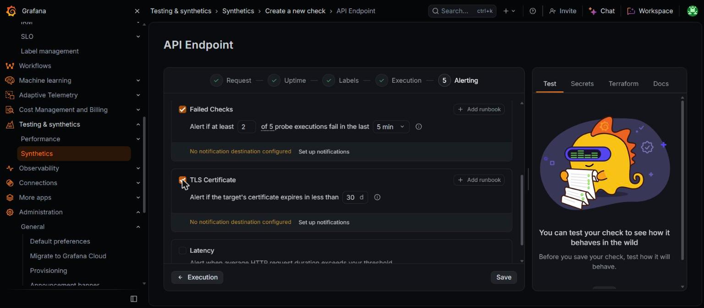
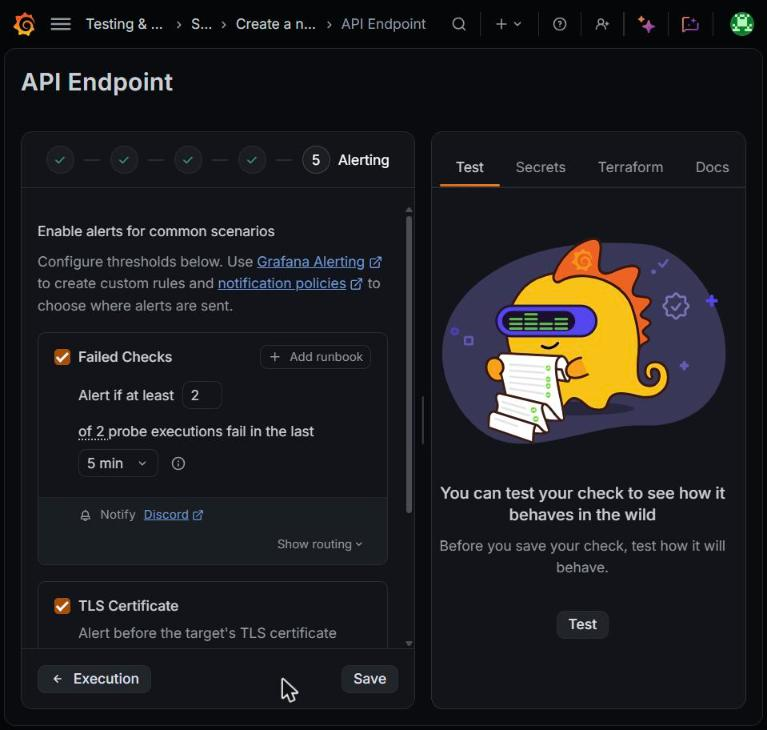
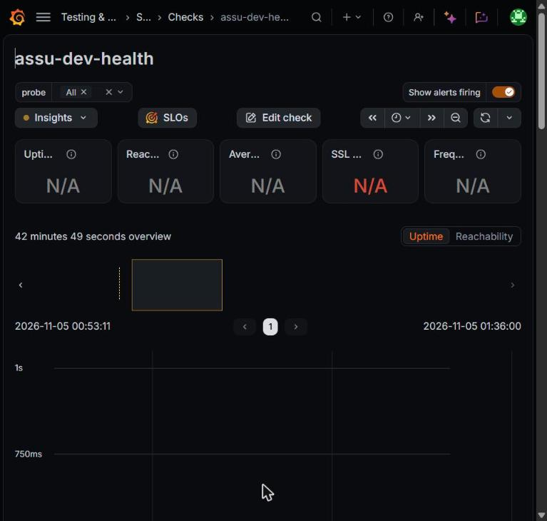

# Assu 모니터링(Metric / Log) 가이드

> 최종 수정: 2026-11-05 · 수정자: 2ghrms

Grafana Cloud(무료 티어)와 클러스터 안의 Grafana Alloy로 메트릭과 로그를 수집한다. Trace는 아직 없다(#518에서 Tempo 도입 예정).

이 문서는 지금 무엇이 수집되는지, 대시보드와 알람을 어디서 보고 어떻게 바꾸는지, 장애 때 어떤 지표를 어떤 순서로 보는지를 다룬다.

클러스터 구조, 배포 흐름, `kubectl` 접속, 헬스체크 probe 설정은 [배포운영가이드](배포운영가이드.md)에 있다.

### 알려진 한계 (2026-11-05 기준)

| 한계 | 영향 | 후속 |
|---|---|---|
| 앱 Alloy가 앱 **Service 주소 1개**를 스크레이프한다 | 파드가 2대 이상이면 요청 하나가 매번 다른 파드로 가므로 **1대분만 집계**된다. 롤링 배포 중에도 수치가 왜곡된다 | #518 파드 discovery로 전환(`pod` 라벨 확보) |
| 앱 지표는 Tomcat 대기열과 Ingress 단계의 실패를 못 본다 | 부하테스트에서 체감 p95 20초일 때 앱 지표는 251ms였다. readiness 실패로 Traefik이 503을 줘도 `http_server_requests`에는 200만 남는다 | Traefik 지표 수집(manifest#21)과 외부 probe(3-4)로 보완했다. 대시보드 반영은 #520 |
| 대시보드에 CPU throttling·배포 시점·Ingress 5xx·RDS 패널이 없다 | 부하 장애 원인을 대시보드만으로 찾기 어렵다. 4-4의 쿼리를 Explore에서 직접 쓴다 | Overview / drill-down 분리(#520) |
| recording rule, SLO burn-rate 알람 없음 | 알람이 고정 임계값이라 느린 성능 저하를 조기에 못 잡는다 | #519 |

---

## 1. 수집 구조

### 1-1. 전체 그림

```text
[assu-prod / assu-dev 네임스페이스]

  assu-{env}-app (Spring Boot)
    ├─ :8080  API 트래픽 ◀── Ingress(Traefik) ◀── 사용자
    └─ :8081  /actuator/health/*, /actuator/prometheus   (클러스터 내부 전용)
          ▲
          │ scrape  (assu-{env}-app-service:8081, 60초 주기)
          │
  alloy (Deployment, 네임스페이스마다 1개)
    ├─ prometheus.scrape ──▶ prometheus.remote_write ──▶ Grafana Cloud Prometheus (env 라벨)
    └─ loki.source.kubernetes (같은 네임스페이스의 모든 파드 로그) ──▶ Grafana Cloud Loki (env 라벨)

[assu-monitoring 네임스페이스]

  k8s-monitoring Helm 차트 4.5.0 (ArgoCD App: assu-cluster-monitoring)
    ├─ node-exporter        노드 CPU/메모리/디스크
    ├─ kube-state-metrics   파드 재시작, Deployment 상태
    └─ alloy-daemon         kubelet/cadvisor 수집 ──▶ Grafana Cloud (cluster=assu-k3s)

                     ▼
       Grafana Cloud (대시보드 / Explore / Alerting) ──▶ Discord
```

### 1-2. 구성 요소와 정의 위치

`manifest`는 비공개 레포 `ASSU_BE_manifest`다.

| 구성 요소 | 역할 | 정의 위치 |
|---|---|---|
| Actuator + Micrometer | 앱 메트릭 생성, `/actuator/prometheus` 노출 | `build.gradle`, `application.yml`, `config/{dev,prod}` |
| 앱용 Alloy (`grafana/alloy:v1.19.2`) | 앱 스크레이프 + 네임스페이스 파드 로그 전송 | `manifest/base/alloy/`, `manifest/overlays/{env}/alloy-patch.yaml` |
| k8s-monitoring 차트 | 클러스터 지표 수집 | `manifest/argocd/monitoring-application.yml`, `manifest/monitoring/values.yaml` |
| 대시보드 JSON | 대시보드 원본 (Git Sync) | `manifest/monitoring/dashboards/*.json` |
| 알람 규칙 JSON | 알람 원본 (GitHub Actions) | `manifest/monitoring/alerting/assu-slo.json`, `manifest/.github/workflows/grafana-alerting.yml` |
| Discord Contact point | 알람 발송 웹훅 | Grafana Cloud UI만 (웹훅 URL이 비밀값이라 git 제외) |

Grafana Cloud 스택 주소는 레포에 적지 않는다. 로컬 `~/.assu/infra.env`의 `GRAFANA_URL`을 쓴다.

### 1-3. 앱 설정

- `config/{dev,prod}`에서 `management.server.port: 8081`로 actuator를 분리했다. Ingress는 8080만 라우팅하므로 메트릭은 외부에서 보이지 않는다. `local`은 분리하지 않아 `curl http://localhost:8080/actuator/prometheus`로 확인한다.
- 클러스터에서 직접 확인할 때는 port-forward를 쓴다.

```bash
kubectl port-forward svc/assu-dev-app-service 8081:8081 -n assu-dev
```

port-forward를 띄워 둔 채 다른 터미널에서 조회한다.

```bash
curl -s http://localhost:8081/actuator/prometheus | grep http_server_requests
```

`application.yml`의 메트릭 설정은 다음과 같다.

```yaml
management:
  endpoints:
    web:
      exposure:
        include: "health,prometheus"
  endpoint:
    health:
      probes:
        enabled: true
  metrics:
    tags:
      application: ${spring.application.name}
    distribution:
      slo:
        http.server.requests: 50ms,100ms,200ms,500ms,800ms,1s,2s,5s,10s,30s
        certification.group.duration: 100ms,500ms,1s,3s,10s,30s
```

- `application` 태그가 없으면 JVM 대시보드가 `application` 변수로 필터링하지 못해 전부 N/A가 된다.
- `slo` 버킷은 P95/P99 계산용 `_bucket` 시계열을 만든다. `percentiles-histogram: true`는 타이머당 버킷이 약 70개라 무료 티어 시계열 한도를 위협하므로 필요한 경계만 지정했다. 800ms는 지연 알람 임계값에 맞췄다.
- `probes.enabled`로 `/actuator/health/liveness`, `/readiness`가 열린다. probe는 이 두 경로를 쓰고, DB를 포함하는 `/actuator/health`는 probe에 쓰지 않는다(manifest#14).

### 1-4. 수집 주기와 `rate()` 창

앱 Alloy의 `prometheus.scrape`에는 주기 설정이 없어 기본값 **60초**로 수집한다. `rate()`/`increase()`는 창 안에 샘플이 2개 이상 있어야 값이 나오므로 **`[2m]` 이상**을 쓴다. `[1m]`이면 값이 비거나 0이 된다. 대시보드는 `[5m]`, 5xx 알람은 `[2m]`을 쓴다.

### 1-5. 라벨 규칙

| 라벨 | 값 | 붙는 곳 |
|---|---|---|
| `env` | `prod` / `dev` | 앱 Alloy `external_labels` (앱 메트릭, Loki 로그) |
| `job` | `assu-app` | 앱 Alloy 스크레이프 타깃 |
| `instance` | `assu-{env}-app-service:8081` | 스크레이프 주소. 지금은 파드가 아니라 Service라 파드 구분이 안 된다 |
| `application` | `assu` | Micrometer 공통 태그 |
| `cluster` | `assu-k3s` | k8s-monitoring 차트가 수집한 클러스터 지표 |

같은 스택에 prod와 dev가 같이 들어온다. **쿼리에는 항상 `env`를 건다.**

### 1-6. 수집되는 메트릭

**기본 메트릭 (Spring Boot 자동)**

| 메트릭 | 용도 |
|---|---|
| `http_server_requests_seconds_count / _sum / _bucket` | 요청 수, 지연 (`uri`, `method`, `status`, `outcome` 라벨) |
| `jvm_memory_used_bytes`, `jvm_gc_pause_seconds`, `jvm_threads_live_threads` | JVM 힙/GC/스레드 |
| `hikaricp_connections_active / _pending` | DB 커넥션 풀 (풀 크기 10) |
| `process_cpu_usage`, `system_cpu_usage` | CPU |
| `up{job="assu-app"}` | 스크레이프 성공 여부 |
| `logback_events_total{level}` | 레벨별 로그 수 |
| `rabbitmq_published_total`, `rabbitmq_failed_to_publish_total` | Spring AMQP 발행/실패 |
| `process_start_time_seconds` | 프로세스 시작 시각 (바뀌면 재시작) |

**커스텀 메트릭**

Micrometer 이름의 `.`은 `_`로 바뀌고, Counter에는 `_total`, Timer에는 `_seconds`가 붙는다. WebSocket과 비동기 처리는 HTTP 메트릭에 안 잡혀서 직접 계측했다.

| Prometheus 이름 | 라벨 | 계측 위치 |
|---|---|---|
| `notification_outbox_publish_total` | `result=success\|failure` | `OutboxAfterCommitPublisher` |
| `notification_fcm_send_total` | `result=success\|failure\|exception` | `NotificationListener` (토큰 단위) |
| `notification_outbox_retry_total` | - | `OutboxRetryProcessor` |
| `certification_group_result_total` | `result=completed\|progress\|mismatch\|failure` | `GroupCertificationController` |
| `certification_group_duration_seconds_*` | - | `GroupCertificationController` (SLO 버킷) |
| `chat_message_sent_total` | - | `ChatServiceImpl` (커밋 후 증가) |
| `chat_active_sessions` (Gauge) | - | `PresenceTracker` (STOMP 세션 수) |
| `auth_login_result_total` | `result=success\|failure` | 성공 `LoginServiceImpl`, 실패 `GlobalExceptionAdvice` |
| `auth_ssu_sso_total` | `result=success\|sso_failed\|portal_failed\|parse_failed\|unsupported_major\|other` | `SSUAuthServiceImpl` |
| `auth_refresh_rotate_total` | `result`, `stage=filter\|service`, 필터 실패 시 `reason` | `JwtAuthFilter`, `LoginServiceImpl` |
| `auth_blacklist_failopen_total` | - | `JwtUtil` (Redis 장애로 블랙리스트 조회를 건너뛴 횟수) |
| `inquiry_created_total` | - | `InquiryServiceImpl` (커밋 후 증가) |
| `device_token_registered_total`, `device_token_deleted_total` | - | `DeviceTokenServiceImpl` (커밋 후 증가) |
| `member_profile_image_s3_delete_failure_total` | - | `ProfileImageServiceImpl` (S3 고아 파일 발생) |

**클러스터 메트릭 (k8s-monitoring)**

`clusterMetrics`(kubelet, cadvisor, kube-state-metrics)와 `hostMetrics`(node-exporter)를 수집한다. control 노드는 메모리 여유가 없어 수집 DaemonSet에서 제외했다(`tolerations: []`). 그래서 `node_*` 지표는 control 노드에 없다.

| 메트릭 예시 | 용도 |
|---|---|
| `container_cpu_cfs_throttled_periods_total`, `container_cpu_cfs_periods_total` | 컨테이너 CPU throttling 비율 |
| `container_cpu_usage_seconds_total` | 컨테이너 CPU 사용량 |
| `node_memory_MemAvailable_bytes`, `node_filesystem_avail_bytes` | 노드 메모리/디스크 여유 |
| `kube_pod_container_status_restarts_total` | 파드 재시작 |
| `kube_deployment_status_replicas_available` | Deployment 가용 replica |

alloy-daemon은 클러스터링으로 대상을 나눠 맡고, 다른 노드의 kubelet(10250)·node-exporter(9100)에는 노드 IP로 직접 붙는다. 노드 보안그룹끼리 이 포트가 막히면 같은 시계열에 `up=1`/`up=0`이 번갈아 찍힌다.

### 1-7. 새 커스텀 메트릭 추가

`MeterRegistry`를 주입받는다. 트랜잭션 안이면 롤백된 작업이 집계되지 않도록 커밋 후에 증가시킨다(`ChatServiceImpl.incrementAfterCommit()` 참고).

```java
meterRegistry.counter("review.created", "result", "success").increment();
```

**카디널리티 규칙 (무료 티어라 반드시 지킨다)**

- 라벨 값은 몇 개로 고정되는 값만 쓴다: `result=success|failure` 등.
- `memberId`, `storeId`, `requestId`, IP, 에러 메시지처럼 값이 계속 늘어나는 건 라벨로 넣지 않는다. 개별 요청 추적은 로그 + reqId로 한다.
- 대시보드 패널이 필요하면 `manifest/monitoring/dashboards/assu-app-overview.json`도 같이 고친다(2-1).

### 1-8. 로그

앱용 Alloy의 `loki.source.kubernetes`가 자기 네임스페이스의 모든 파드 로그(앱, Redis, RabbitMQ, Alloy)를 Loki로 보낸다. 앱은 stdout으로만 쓰면 된다.

| Loki 라벨 | 예시 |
|---|---|
| `instance` (`<namespace>/<pod>:<container>`) | `assu-prod/assu-prod-app-7d9f8c6b5-x2k4p:assu` |
| `env` | `prod` / `dev` |
| `job`, `service_name` | `loki.source.kubernetes.pods` (모든 스트림 동일) |

**로그 레벨**: local은 Spring web/messaging DEBUG, dev는 `com.assu.server: DEBUG`, prod는 기본 INFO다. prod에 DEBUG를 켜지 않는다(민감정보, 로그량).

**Request ID**: `RequestIdFilter`가 요청마다 UUID를 발급해 MDC(`requestId`)에 넣는다. 모든 로그 라인에 `[reqId=...]`로 찍히고 응답 헤더 `X-Request-Id`로 내려간다. 프론트/QA가 이 값을 주면 Loki에서 그 요청 로그만 뽑을 수 있다. RabbitMQ 리스너, WebSocket 처리처럼 HTTP 요청 스레드 밖의 로그에는 reqId가 비어 있다.

**정해진 로그 접두사**

| 접두사 | 위치 | 용도 |
|---|---|---|
| `[LOGIN_FAIL] ip= uri= reason=` | `GlobalExceptionAdvice` (WARN) | 로그인 실패. IP별 알람이 이 로그를 집계한다 |
| `[AUTH_CHAIN] stage=` | `JwtAuthFilter`, `RoutingAuthenticationProvider`, 인증 어댑터 (DEBUG) | 인증 실패 단계 추적. prod에서는 꺼져 있다. 토큰·비밀번호·이메일·학번은 남기지 않는다 |
| `[Outbox]`, `[Notify]` | 알림 발행/전송 | 푸시 알림 흐름 |
| `처리되지 않은 예외 발생` | `GlobalExceptionAdvice` (ERROR) | 미처리 예외, 스택트레이스 포함 |

### 1-9. Secret

Grafana Cloud 자격증명은 git에 없고 클러스터에 수동으로 만들었다.

| 항목 | 내용 |
|---|---|
| Secret 이름 | `grafana-cloud-creds` (`assu-prod`, `assu-dev`, `assu-monitoring`) |
| 키 | `prometheus-url`, `prometheus-username`, `loki-url`, `loki-username`, `api-token` |
| 알람 동기화 토큰 | GitHub Secret `GRAFANA_SA_TOKEN` (manifest 레포, 서비스 계정 토큰) |
| Git Sync 토큰 | GitHub fine-grained PAT (manifest 레포 한정) |

토큰은 만료가 있다. `api-token`을 재발급하면 세 네임스페이스 Secret을 모두 갱신하고 Alloy를 재시작한다. `GRAFANA_SA_TOKEN`이나 PAT가 만료되면 알람 동기화 Actions가 실패하거나 Git Sync가 멈춘다.

```bash
kubectl rollout restart deployment alloy -n assu-prod
kubectl rollout restart deployment alloy -n assu-dev
kubectl rollout restart daemonset -n assu-monitoring
```

### 1-10. 수집 설정 변경 체크리스트

manifest main 머지는 ArgoCD가 바로 반영하고, 앱 설정은 이미지가 새로 빌드돼야 반영된다.

1. `monitoring/values.yaml`을 바꾸면 머지 전에 control 노드에서 `helm template`으로 렌더링해 control 노드 제외(tolerations)와 수집 파이프라인을 확인한다.
2. `argocd/` 아래 Application을 새로 만들면 클러스터에 직접 `kubectl apply` 한다. ArgoCD는 이 폴더를 자동 반영하지 않는다.
3. Alloy ConfigMap을 바꾸면 Alloy가 자동으로 다시 읽지 않으므로 prod/dev Alloy를 `rollout restart` 한다.
4. 반영 후 Grafana에서 `up{job="assu-app"}`, `up{job=~"integrations/.*"}`가 모두 1인지, Usage 화면의 활성 시계열 수를 확인한다.

### 1-11. 트러블슈팅

| 증상 | 원인 | 해결 |
|---|---|---|
| JVM 대시보드 전부 N/A | `application` 라벨 없음 | `management.metrics.tags.application` 확인 |
| 그래프 값이 0 또는 빈칸 | `rate(...[1m])` 사용 (수집 주기 60초) | 창을 `[2m]` 이상으로 |
| 파드 2대인데 처리량이 실제의 절반 | Alloy가 Service 1개만 스크레이프 | #518 전까지는 k6/Traefik 기준으로 판단 |
| 파드가 Ready 안 됨 | probe 포트(8081)와 앱 management 포트 불일치 | 앱 config와 manifest 포트 변경을 같이 배포 |
| dev Alloy `rollout restart`가 멈춤 (`exceeded quota`) | dev 쿼터 여유가 새 파드보다 작음 | dev Alloy는 `strategy: Recreate`로 되어 있다. 그래도 막히면 쿼터 확인 |
| Alloy 재시작 직후 `loki.write ... timestamp too old` 1회 | 오래된 파드 로그를 처음부터 다시 읽어 Loki 허용 범위를 벗어남 | 무시. 계속 반복될 때만 확인 |
| node-exporter·kubelet `up`이 1/0으로 튐 | 노드 간 TCP 9100·10250이 보안그룹에 막힘 | 노드 보안그룹끼리 허용. 노드를 새로 만들면 같이 추가 |

---

## 2. 대시보드와 알람을 바꾸는 법

둘 다 **git이 원본**이다. UI에서 직접 고친 내용은 유지되지 않거나(알람) PR로 돌아온다(대시보드).

### 2-1. 대시보드: Grafana Git Sync

| 항목 | 값 |
|---|---|
| 원본 | `manifest/monitoring/dashboards/*.json` (main) |
| 연결 | Grafana Provisioning(Git Sync), 레포 연결 이름 `ASSU Dashboards`, 경로 `monitoring/dashboards` |
| 데이터소스 | JSON 안에서 uid `grafanacloud-prom`으로 고정 (변수 `${DS_PROMETHEUS}` 쓰지 않음) |
| 무료 플랜 한도 | Git Sync 레포 1개, 레포당 리소스 20개 |

- **git에서 고칠 때**: JSON 수정 → manifest PR → main 머지 → Grafana가 Pull 하면 반영된다.
- **UI에서 고칠 때**: 저장하면 Grafana가 manifest 레포에 PR을 만든다. PR이 머지돼야 원본에 남는다.
- **첫 Pull은 아직 실행하지 않았다.** 운영자가 Grafana `/admin/provisioning`에서 `ASSU Dashboards` 연결을 열어 Pull을 실행해야 git 원본이 Grafana에 올라간다.
- 새 대시보드 JSON을 추가할 때는 `id`, `version`, `__inputs` 같은 Import 전용 필드를 빼고, 데이터소스는 uid로 고정한다. 리소스 20개 한도를 넘지 않는지 본다.

### 2-2. 알람: GitHub Actions → provisioning API

| 항목 | 값 |
|---|---|
| 원본 | `manifest/monitoring/alerting/assu-slo.json` (provisioning API 형식, rule group `assu-slo`, 평가 주기 60초) |
| 동기화 | `.github/workflows/grafana-alerting.yml`. main에 `monitoring/alerting/**` 변경이 push되면 실행. 수동 실행(`workflow_dispatch`)도 된다 |
| 호출 | `PUT /api/v1/provisioning/folder/{folderUid}/rule-groups/{title}`, 인증은 Secret `GRAFANA_SA_TOKEN` |
| UI 수정 | 불가. 동기화된 규칙은 provenance=api라 잠긴다 |

**알람 규칙을 바꾸는 순서**

1. `assu-slo.json`의 해당 규칙을 고친다. 새 규칙은 기존 규칙을 복사해 `uid`, `title`, 쿼리, 임계값을 바꾼다.
2. 라벨 `severity`(`critical`/`warning`), `team=assu`를 붙이고 `notification_settings.receiver`를 `Discord`로 둔다. receiver를 빼면 알림이 어디로도 가지 않는다(기본 정책의 receiver가 비어 있다).
3. annotation `summary`, `description`에 대응 순서를 적는다. Discord 메시지 본문이 여기서 나온다.
4. manifest PR → 머지 → Actions 성공 확인 → Grafana Alerting 화면에서 규칙 반영 확인.
5. 이 문서 3-2 표를 갱신한다.

**Contact point / 알림 정책**은 웹훅 URL이 있어 git에 넣지 않았다. UI(Alerting → Contact points)에서 관리한다. Discord 메시지 템플릿도 여기 있다.

---

## 3. 알람

### 3-1. Discord로 오는 알림

| 종류 | 발송 주체 | 설정 위치 |
|---|---|---|
| 배포 알림 | GitHub Actions | `.github/workflows/cd-{dev,prod}-argocd.yml` (`DISCORD_WEBHOOK_URL`) |
| 장애/지표 알람 | Grafana Cloud Alerting | 2-2 |

- 배포 알림의 `success`는 "이미지 빌드 + manifest 태그 갱신 커밋 성공"이다. 파드가 새 버전으로 떴다는 뜻이 아니다. 실제 반영은 `up`, 요청률, 에러율로 확인한다.
- 배포 웹훅은 `|| true`라 전송 실패해도 CD는 성공으로 남는다.
- Grafana 알람은 발생 시 `🔴 ASSU 장애 알림`, 해소 시 `✅ ASSU 정상 복구` 제목으로 온다. `critical`은 🚨, `warning`은 ⚠️. 시각은 UTC다(KST는 +9시간).
- 메시지의 `환경`은 라벨 `env`, 본문은 annotation `description`에서 나온다. 규칙에 둘 중 하나가 없으면 그 자리가 비어서 온다. 외부 probe 알람(3-4)은 Synthetic 플러그인이 만든 규칙이라 기본적으로 둘 다 없어서, `env`를 job 이름(`assu-<env>-health`)에서 뽑는 템플릿 라벨과 한국어 `description`을 provisioning API로 넣어 두었다. 플러그인이 규칙을 초기화하면 다시 넣어야 한다.

### 3-2. 등록된 알람 규칙 (`assu-slo`, 16개, 모두 prod 전용)

모든 규칙이 `env="prod"`만 본다. dev는 부하테스트와 Recreate 배포로 수시로 흔들려 알람 대상에서 뺐다(manifest#20). 평가 주기는 60초, 목표는 "장애 발생 후 5분 안에 Discord에 도착"이다.

| 알람 | 보는 것 | 조건 | Pending | 심각도 |
|---|---|---|---|---|
| 앱 다운 | `up{job="assu-app"}` | `< 1` | 1m | critical |
| 앱 컨테이너 재시작 | `kube_pod_container_status_restarts_total` 증가 | `> 0` | 0s | critical |
| 5xx 비율 급증 | 5분간 5xx / 전체 | `> 5%` | 0s | critical |
| 5xx 에러 발생 | uri·status별 5xx 건수 | `> 0` | 0s | warning |
| 응답 지연 SLO 위반 | 1초 이내 응답 비율(히스토그램 `le="1.0"`) | `< 90%` | 2m | critical |
| 평균 응답 지연 상승 | 5분 평균 지연 | `> 300ms` | 3m | warning |
| CPU throttling 지속 | 앱 컨테이너 CFS throttled 비율 | `> 25%` | 3m | warning |
| 처리 중 요청 적체 | `http_server_requests_active_seconds_count` 합계 | `> 50` | 1m | warning |
| DB 커넥션 풀 대기 발생 | `hikaricp_connections_pending` 3분 최대 | `> 0` | 2m | warning |
| RDS 커넥션 한도 근접 | 전 환경 `hikaricp_connections` 합계 (RDS 한도 약 30) | `> 23` | 2m | critical |
| 확장 한계 도달 | HPA 2대 + CPU 400m 초과 (prod HPA 보류 중이라 지금은 울리지 않음) | `> 0` | 10m | warning |
| JVM 힙 사용률 90% 초과 | heap used / max | `> 0.9` | 5m | warning |
| ERROR 로그 급증 | `logback_events_total{level="error"}` 5분 증가 | `> 5` | 0s | warning |
| RabbitMQ 메시지 발행 실패 | `rabbitmq_failed_to_publish_total` 10분 증가 | `> 0` | 0s | warning |
| 로그인 실패 반복 | Loki: 동일 IP `[LOGIN_FAIL]` 1분 집계 | `> 5` | 0s | warning |
| 로그인 실패 공격 의심 | 위와 같은 쿼리 | `> 10` | 0s | critical |

- No data는 앱 다운만 Alerting이다. 수집이 끊긴 것 자체가 장애이기 때문이다. 나머지는 트래픽이 없어 결과가 비는 시간이 많아 OK로 둔다.
- 처리 중 요청·throttling·커넥션 대기 규칙은 부하테스트 백테스트에서 나온 것이다. 과부하 때 앱의 응답 시간 지표는 Tomcat 대기열을 못 봐서 정상처럼 보였고, 이 세 지표만 반응했다.
- RDS 커넥션 규칙만 prod·dev 합계를 본다. 한 RDS를 두 환경이 나눠 쓰기 때문이다.
- IP별 집계는 Loki 로그로 한다. IP를 메트릭 라벨로 넣으면 시계열이 끝없이 늘어난다(1-7).
- prod 트래픽이 적어 비율보다 건수 기준이 많다. 오탐이면 PR로 임계값·Pending을 고친다.

### 3-3. 알람을 받았을 때

```text
1) 알람 이름과 env 확인, Discord 스레드에 "확인 중" 남기기
2) ASSU App Overview에서 env 선택, 알람 시각 전후로 시간 범위 조정
3) 엔드포인트별 상세 테이블과 도메인 패널로 범위 좁히기
4) Explore(Loki)에서 그 시각 ERROR 로그 → reqId로 요청 추적
5) 파드 문제면 kubectl describe / logs --previous / get events
6) 배포 직후라면 롤백 검토. 원인과 조치를 스레드에 남기기
```

| 알람 | 먼저 볼 것 |
|---|---|
| 앱 다운 | `kubectl get pods`, `describe`(OOMKilled), `logs --previous`, 직전 배포 알림 |
| 5xx 에러 발생 | 알람의 `uri` → 엔드포인트 테이블 → Loki `처리되지 않은 예외 발생` |
| 평균 응답 지연 | 4-3의 용량 신호 순서대로 (throttling → 커넥션 대기) |
| JVM 힙 | JVM 대시보드 힙/GC 추이. 계속 오르기만 하면 누수 |
| DB 커넥션 풀 대기 | 느린 엔드포인트, 긴 트랜잭션, RDS CPU |
| ERROR 로그 급증 | Loki ERROR 로그. `[Outbox]`, `[Notify]`, `### ERROR ###`(그룹 인증) 중 무엇인지 |
| RabbitMQ 발행 실패 | `rabbitmq-0` 파드 상태, `[Outbox]` 로그 |
| 처리 중 요청 적체 / CPU throttling | 앱 CPU가 limit(2코어)에 붙어 있는지, 트래픽 급증인지. 노드 CPU도 같이 본다 |
| RDS 커넥션 한도 근접 | dev에서 부하테스트 중인지 먼저 확인. prod 풀 10 + dev 풀 2가 기본 |
| ProbeFailedExecutionsTooHigh (외부 probe) | 3-4. DNS → TLS → Traefik → 앱 순으로 어디서 끊겼는지 Synthetic 화면의 에러 메시지로 판단 |

- 오탐이면 무시하지 말고 임계값/Pending을 PR로 고친다.
- 계획된 작업 전에는 Alerting → Silences로 음소거한다(Silence는 UI에서 해도 된다).

### 3-4. 외부 probe: Grafana Cloud Synthetic Monitoring

앱 지표는 앱이 살아 있을 때만 나온다. 앱·노드·Traefik·DNS·인증서 중 어디가 죽어도 사용자 입장에서 "안 열린다"를 잡으려고 Grafana Cloud가 외부(서울 AWS 프로브)에서 HTTPS로 health를 호출한다. 트래픽이 0인 새벽에도 동작하는 유일한 감시다.

| 체크 | 대상 | 주기 | 실패 알람 | 인증서 알람 |
|---|---|---|---|---|
| `assu-prod-health` | `https://prod.assu.site/actuator/health/readiness` | 1분 | 5분간 5회 중 2회 실패 | 만료 30일 전 |
| `assu-dev-health` | `https://dev.assu.site/actuator/health/readiness` | 2분 | 5분간 2회 중 2회 실패 | 만료 30일 전 |

- 위치: Grafana 좌측 메뉴 **Testing & synthetics → Synthetics → Checks**. 체크는 UI에서 만들고 관리한다(git 원본 없음). 무료 티어 한도는 월 10만 실행이고 두 체크가 약 6.7만을 쓴다. 체크를 더 만들면 주기를 늘려야 한다.
- `/actuator/health`는 management 포트(8081)에만 있어서 Ingress에 `/actuator/health` 경로를 8081로 따로 열어 두었다(manifest#27). 이걸 빼면 외부에서는 401이 돌아와 체크가 항상 실패한다. `/actuator/prometheus`는 열려 있지 않다.
- readiness 그룹은 Spring 기본값(readinessState만)이라 DB가 죽어도 이 체크는 통과한다. DB 장애는 3-2의 5xx·커넥션 규칙이 잡는다.
- 알람은 플러그인이 만든 규칙 `ProbeFailedExecutionsTooHigh`, `TLSTargetCertificateCloseToExpiring`(폴더 Grafana Synthetic Monitoring)이 발생시키고, 알림 정책의 `namespace=synthetic_monitoring` 라우트가 Discord로 보낸다. 반복 알림 주기는 4시간이다.
- 체크의 Alerting 단계에서 "No notification destination" 경고가 보이면 알림 정책에 위 라우트가 없는 것이다. Alerting → Notification policies에서 matcher `namespace = synthetic_monitoring`, contact point Discord로 추가한다.

**체크 만드는 순서** (dev 체크를 만들 때 찍은 화면)

1. Checks 목록에서 **Create new check**를 누른다.

   

2. 유형은 **API Endpoint**를 고른다. Multi Step·Scripted·Browser는 실행 비용이 크다.

   

3. **Request**: Job name은 `assu-<env>-health`로 짓는다. Discord 메시지의 환경 표시가 이 이름에서 나온다. Request type은 HTTP, target은 readiness URL이다.

   

4. **Uptime**: 기본값(2xx 허용, SSL 무시)을 그대로 둔다.

   

5. **Labels**: 비워 둔다. **Execution**: 프로브는 기본 선택된 Calgary를 끄고 **Seoul, KR (AWS)** 하나만 켠다. 주기는 prod 1분, dev 2분. 아래 "Test executions per month"로 한도를 확인한다.

   

6. **Alerting**: Failed Checks를 켜고 임계값을 정한다(prod는 5회 중 2회, dev는 2회 중 2회). TLS Certificate도 켠다(30일). 아래에 Notify Discord가 보이면 라우팅이 된 것이다.

   

   

7. **Save**. 저장 직후에는 지표가 N/A이고 2~3분 뒤부터 Uptime·Reachability가 채워진다.

   

**실패했을 때 보는 곳**: 체크 상세 화면의 Reachability 그래프와 로그(Explore → Loki, `{source="synthetic-monitoring-agent", job="assu-prod-health"}`)에 프로브가 받은 HTTP 코드와 에러가 남는다. 401이면 Ingress 경로 문제, timeout이면 노드·Traefik·보안그룹, TLS 에러면 cert-manager를 본다.

---

## 4. 대시보드 보는 법

### 4-1. 접속과 목록

스택 주소는 `~/.assu/infra.env`의 `GRAFANA_URL`, 계정은 팀 노션 Account 페이지에 있다. 계정 정보는 문서·슬랙·커밋에 옮겨 적지 않는다. 조회만 하면 Viewer 권한이면 된다.

| 대시보드 | uid | 용도 |
|---|---|---|
| ASSU App Overview | `asgmnph` | 앱 상태, 도메인별 요청률/지연, 커스텀 메트릭. `GRAFANA_URL/d/asgmnph` |
| JVM (Micrometer) | `as27jbl` | 힙, GC, 스레드, CPU, 로그 이벤트. 상단 `instance`에서 `assu-{env}-app-service:8081` 선택 |
| Kubernetes Monitoring | - | Grafana Cloud 기본 제공(Observability → Kubernetes). 노드/파드 리소스, 재시작 (`cluster=assu-k3s`) |

### 4-2. ASSU App Overview

- 상단 `env` 변수(`prod`/`dev`)를 **가장 먼저** 확인한다. 기본 범위는 최근 3시간, 30초 새로고침이다.
- 요청 지표는 `uri=UNKNOWN`(컨트롤러 매핑 없음)과 Swagger를 제외하고, `매칭 안 된 요청` 패널에 따로 보여준다.

| 영역 | 보는 포인트 |
|---|---|
| 요약 (요청률, 5xx %, P95, P99) | P95 0.5s 주황 / 0.8s 빨강 |
| 앱 상태 (수집 성공, 1h 재시작, 힙, DB 커넥션 활성/대기, 10m ERROR, 미매칭 요청) | 장애 제보가 오면 이 행부터 본다 |
| 도메인별 (학생, 인증, QR 인증, 제휴/가게/지도, 일반 API, 학생회/제휴업체/백오피스) | 요청률은 status별, P95는 uri별. 배포 직후 특정 uri의 400/401이 튀면 API 호환성 문제를 의심 |
| 매칭 안 된 요청 | 없는 경로·잘못된 메서드·스캐너. 배포 직후 급증하면 클라이언트가 바뀐 경로를 호출하는지 확인 |
| 엔드포인트별 상세 (상위 20 + P95) | 원인 엔드포인트를 좁힐 때 가장 먼저 본다 |
| 커스텀 도메인 메트릭 | Outbox 발행, FCM(토큰 단위, 재시도는 우측 축), 그룹 QR 결과/소요시간, 채팅, 문의 접수, 디바이스 토큰, 프로필 이미지 S3 삭제 실패 |

**알아둘 점**

- P95/P99는 SLO 버킷 사이를 보간한 근사치다. 30초를 넘는 요청이 1%를 넘으면 P99는 30s에 붙어 보인다.
- 트래픽이 없으면 P95/P99는 No data다. 장애가 아니다.
- 지표가 `[5m]` 창이라 변화가 수 분 늦게 보인다. 배포 직후 1~2분은 판단을 보류한다.
- 파드가 2대 이상이면 모든 패널이 1대분이다(알려진 한계).
- 그룹 QR 결과: `completed` 완료, `progress` 인원 추가, `mismatch` 학생회 불일치, `failure` 예외.

### 4-3. 장애 연쇄와 봐야 할 지표

부하테스트(dev를 prod 사양으로 맞춰 k6 측정)에서 앱 1대는 **초당 약 20~25건**이 한계였고, 넘으면 아래 순서로 무너졌다. 앞 단계 지표가 먼저 움직이므로 이 순서대로 본다.

| 순서 | 현상 | 볼 지표 |
|---|---|---|
| 1 | 컨테이너 CPU limit에 걸려 throttling. 노드 CPU에는 여유가 있어도 생긴다 | throttling 비율, 컨테이너 CPU 사용량 |
| 2 | 요청이 느려지며 DB 커넥션을 오래 쥐어 HikariCP 풀(10개) 고갈 | `hikaricp_connections_pending`, `_active` |
| 3 | 헬스체크 타임아웃(3초) → readiness 실패 | `kubectl get events`의 `Readiness probe failed` |
| 4 | Traefik이 파드를 제외하고 `503` 반환. **앱 지표에는 안 남는다** | 사용자 제보, k6/외부 확인, 이벤트 |

판단 기준은 다음과 같다.

| 신호 | 의미 | 조치 |
|---|---|---|
| throttling 높음, 커넥션 대기 없음 | 앱 CPU 부족 | limit 상향 또는 스케일아웃 |
| 커넥션 대기 > 0, RDS CPU 낮음 | 커넥션 점유가 김 | 쿼리·트랜잭션 개선 먼저 |
| RDS CPU 70% 이상 | DB 한계 | 앱 증설 금지(악화). 쿼리·캐시·RDS 상향 |
| 노드 CPU 70% 이상 | 노드 한계 | 노드 상향 |

헬스체크를 liveness/readiness로 분리해(manifest#14) 3단계의 DB 지연이 liveness 재시작으로 번지지는 않는다.

### 4-4. Explore — PromQL

데이터소스 `grafanacloud-prom`을 고른다. 창은 `[2m]` 이상.

- 엔드포인트별 status 요청률: `sum by (status) (rate(http_server_requests_seconds_count{env="prod", uri="/certification/personal"}[5m]))`
- 5xx 상위 5개 엔드포인트: `topk(5, sum by (uri, method) (rate(http_server_requests_seconds_count{env="prod", status=~"5.."}[15m])))`
- 앱 컨테이너 CPU throttling 비율: `sum(rate(container_cpu_cfs_throttled_periods_total{namespace="assu-prod", container="assu"}[5m])) / sum(rate(container_cpu_cfs_periods_total{namespace="assu-prod", container="assu"}[5m]))`
- DB 커넥션 대기 / 활성: `max by (env) (hikaricp_connections_pending{env="prod"})`, `max by (env) (hikaricp_connections_active{env="prod"})`
- 최근 하루 앱 재시작 횟수(배포 포함): `changes(process_start_time_seconds{job="assu-app", env="prod"}[1d])`

### 4-5. Explore — LogQL

데이터소스 `grafanacloud-logs`를 고른다. 한 줄씩 붙여 넣는다.

```logql
{env="prod", instance=~"assu-prod/assu-prod-app-.*"} |= "ERROR"
{env="prod", instance=~"assu-prod/assu-prod-app-.*"} |= "처리되지 않은 예외 발생"
{env="prod", instance=~"assu-prod/assu-prod-app-.*"} |= "reqId=<X-Request-Id 값>"
{env="prod", instance=~"assu-prod/assu-prod-app-.*"} |~ "\\[Outbox\\]|\\[Notify\\]"
{env="dev", instance=~"assu-dev/assu-dev-app-.*"} |= "[AUTH_CHAIN]" |= "reqId=<X-Request-Id 값>"
{instance=~"assu-prod/(redis|rabbitmq)-0:.*"}
```

Loki는 파드가 교체돼도 보존 기간 동안 로그가 남는다. 크래시루프 중이면 `kubectl logs`보다 Loki가 편하다.

### 4-6. 장애 조사 예시: "푸시 알림이 안 온다"

1. `알림 Outbox 발행` 패널에 `failure`가 있으면 RabbitMQ 문제 → `rabbitmq-0` 상태와 로그.
2. `FCM 발송` 패널의 `exception`/`failure`, 재시도 증가를 본다.
3. Loki `[Notify]` 로그의 `invalidTokens`, `fail=`로 토큰 만료인지 FCM 문제인지 구분한다.
4. 3회 재시도 후에도 실패한 건은 백오피스에서 수동 재전송한다.

### 4-7. 무료 티어 주의

- 활성 시계열 수, 로그 용량, 보존 기간에 한도가 있다. 최신 한도는 Grafana Cloud 요금 페이지와 Usage 화면에서 확인한다.
- 시계열이 갑자기 늘었다면 누군가 값이 무한히 늘어나는 라벨을 추가했을 가능성이 크다(1-7).
- dev는 DEBUG라 로그량이 많다. 로그 용량이 부족하면 dev 레벨부터 낮춘다.
- 보존 기간이 지나면 데이터가 사라진다. 장애 회고에 쓸 그래프와 로그는 바로 캡처해 둔다.

---

## 5. 용어

| 용어 | 설명 |
|---|---|
| Micrometer | Spring Boot의 메트릭 계측 라이브러리. Counter(증가만), Timer(소요시간 분포), Gauge(현재 값) |
| Grafana Alloy | 메트릭·로그를 수집해 원격 저장소로 보내는 에이전트. scrape로 긁어와 remote_write로 보낸다 |
| `rate()` | Counter의 초당 증가율. 창 안에 샘플이 2개 이상 필요하다 |
| 카디널리티 | 라벨 값 조합의 수. 높을수록 비용과 쿼리 부하가 커진다 |
| Git Sync | Grafana가 git 레포의 대시보드 JSON을 동기화하는 기능. UI 수정은 PR로 돌아온다 |
| provenance | Grafana 리소스의 출처. `api`로 만든 알람 규칙은 UI에서 수정할 수 없다 |
| CPU throttling | 컨테이너가 CPU limit을 다 써서 커널이 실행을 멈추는 것. 노드 CPU가 여유로워도 생긴다 |
| Contact point | 알람을 보낼 곳(Discord 웹훅) |

---

## 변경 이력

| 날짜 | 수정자 | 내용 |
|---|---|---|
| 2026-11-05 | 2ghrms | 알람 규칙 표를 16개(prod 전용)로 최신화, Discord 메시지 env·description 출처 설명, 외부 probe(Synthetic Monitoring) 절과 체크 생성 화면 추가 (#519) |
| 2026-11-03 | 2ghrms | CodeRabbit 리뷰 반영: port-forward와 조회 명령 블록 분리, 토큰 재발급 시 dev·monitoring Alloy 재시작 추가 (#554) |
| 2026-11-02 | 2ghrms | 현재 구성으로 최신화(Grafana Cloud + Alloy, 대시보드 Git Sync, 알람 GitOps, 부하테스트로 확인한 장애 연쇄 지표, 알려진 한계), 낡은 이력·수동 절차 정리, 스택 URL 등 식별 정보 제거, docs/guide로 이동 (#554) |
| 2026-10-06 | 2ghrms | 최초 작성: 관측성 스택(metric·log) 도입과 운영 방법 정리 |
